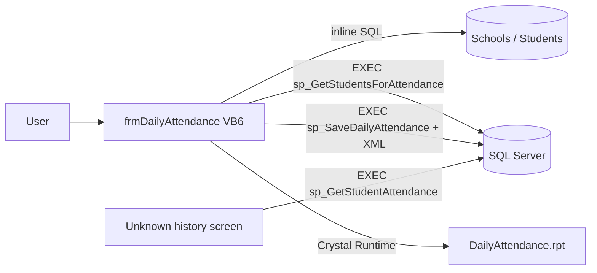
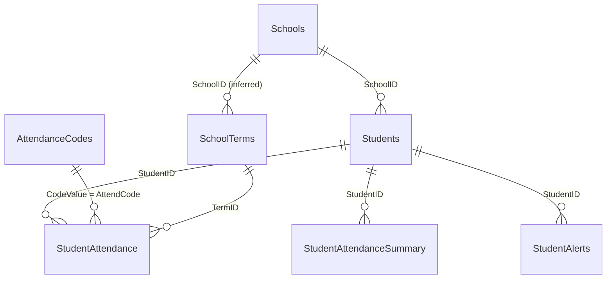

# Legacy Attendance System: Technical Analysis

**System:** K-12 Student Information System, Daily Attendance module (VB6 desktop + SQL Server)
**Reviewed:** 17 Oct 2026
**Purpose:** Describe how the legacy system works today, so the replacement .NET 8 Web API can be designed from it. This document describes the legacy system. It is not a design for the new one.

---

## 1. Scope of the review

Everything in `D:\Projects\AttendanceSystem` was reviewed:

| File | Type | What it is |
|---|---|---|
| `Database/schema.sql` | DDL | 5 tables: Students, AttendanceCodes, StudentAttendance, StudentAttendanceSummary, StudentAlerts |
| `Database/sp_SaveDailyAttendance.sql` | Stored proc | Saves one school's attendance for one day, updates absence totals, raises chronic-absence alerts |
| `Database/sp_GetStudentAttendance.sql` | Stored proc | Returns one student's attendance history for a school year, plus their absence total and chronic status |
| `Forms/frmDailyAttendance.frm` | VB6 form | Daily attendance entry screen (pick school/grade, edit grid, save, print) |

### 1.1 Objects that are referenced but not provided

The code uses the following objects, but their definitions are not in the folder. Their shape below is **inferred from how they are used** and has not been confirmed.

| Object | Kind | Referenced in | Inferred shape |
|---|---|---|---|
| `Schools` | Table | form, both procs | `SchoolID INT`, `SchoolName`, `Active BIT`, `AbsenceAlertThreshold INT NULL` |
| `SchoolTerms` | Table | both procs | `TermID INT`, `SchoolID INT`, `TermName`, `StartDate`, `EndDate` |
| `AttendanceSubmissionLog` | Table | save proc | `SchoolID`, `SubmittedDate`, `AttendDate`, `RecordCount`, `SubmittedBy` (+ probably an identity PK) |
| `sp_GetStudentsForAttendance` | Stored proc | form | `(@SchoolID, @Grade, @Date)`; returns `StudentID, LastName, FirstName, AttendCode, MinutesLate, Notes`. Most likely the active roster left-joined to that day's attendance |
| `SchoolYear()` | Scalar function | save proc | `SchoolYear(date) -> 'YYYY-YYYY'` |
| `Nz()` | VB helper | form | Null-coalesce (an Access function, not built into VB6, so it must live in a missing `.bas` module) |
| `config.ini` | Config file | form | Connection settings (see defect D-12) |
| `Reports\DailyAttendance.rpt` | Crystal Report | form | Daily attendance printout |
| VB6 project file (`.vbp`), other forms/modules | — | — | Not provided. Nothing in the reviewed code calls `sp_GetStudentAttendance`, so another screen must exist |

---

## 2. What the system does

1. A user (presumably a teacher or office staff member) opens **Daily Attendance Entry**, picks a **school**, and optionally a **grade**.
2. The grid loads that school's students and any attendance already recorded **today**. Students with no record default to code **`P`** (presumably "Present"), 0 minutes late, and no notes.
3. The user edits codes, minutes late, and notes, then clicks **Save Attendance**. **Every row in the grid** is sent to the database, including rows that were not touched.
4. The database upserts one attendance row per student per day, recalculates the student's absence total, and raises a **CHRONIC_ABSENCE** alert when the total reaches the school's threshold (default **10**).
5. **Print Report** prints a Crystal Report for the school and date.
6. A separate screen (not provided) shows one student's attendance history and chronic-absence status for a school year.

---

## 3. Data model

There are **no foreign keys, check constraints or secondary indexes** in the schema. All relationships are implicit.

### 3.1 Tables (defined)

**Students:** one row per student. `SchoolID` and `Grade` are single current values, so the schema keeps **no enrollment history** (no entry or withdrawal dates, no transfers). `Grade` is a `VARCHAR(10)` (values such as K, 01 or 1 are unknown).

**AttendanceCodes:** district-wide code list (there is no `SchoolID`). Each code carries two flags, `IsAbsent` and `IsExcused`, plus `IsActive`. `CodeValue` is unique. **No seed data is provided**, so the actual codes (P, A, T, …) are unknown.

**StudentAttendance:** one row per student per day (enforced only by procedure logic, not by a constraint). `IsAbsent` and `IsExcused` are **copied from the code at save time**, so a row keeps the flags its code had when it was saved. It holds `MinutesLate`, `Notes` (max 500 characters), `TermID`, and audit columns.

**StudentAttendanceSummary:** cached absence total per student per school year. The unique key is `(StudentID, SchoolYear)` and does **not** include SchoolID.

**StudentAlerts:** generic alert table. Attendance uses `AlertType = 'CHRONIC_ABSENCE'`. An alert can be resolved (`ResolvedDate`, `ResolvedBy`), but nothing in the provided code resolves alerts.

---

## 4. Process detail

### 4.1 `frmDailyAttendance` (VB6)

| Event | Behaviour |
|---|---|
| `Form_Load` | Opens an ADO connection, loads active schools, and sets the attendance date to **today** (`Date`). The UI has no date picker. |
| `cboSchool_Click` | Stores the SchoolID, loads distinct grades for the school, and loads students. The grade combo is still empty at this point. |
| Grade change | **There is no `cboGrade_Click` handler**, so picking a grade does not reload the grid (unless code we don't have does it). |
| `LoadStudents` | `EXEC sp_GetStudentsForAttendance <school>, '<grade>', '<yyyy-mm-dd>'`, built by string concatenation. Blank code → `P`, blank minutes → `0`. |
| `cmdSave_Click` | Builds `<attendance><r sid="" code="" min="" note=""/>…</attendance>` by string concatenation, sends `EXEC sp_SaveDailyAttendance <school>, '<date>', '<xml>'`, then shows a success message. A blank code becomes `P`. |
| `cmdPrint_Click` | Crystal Report filtered by school and date. The report references an `Attendance` table or view that is not in the schema. |

### 4.2 `sp_SaveDailyAttendance(@SchoolID, @AttendDate, @AttendanceXML)`

1. Shreds the XML into a table variable (`StudentID, AttendCode, MinutesLate, Notes`).
2. Derives the **school year** from the date, with a **1 September** cut-off: Sep 2026 → `2026-2027`, Aug 2026 → `2025-2026`.
3. Looks up the **TermID** whose `StartDate..EndDate` contains the date for that school. If no term matches, TermID is NULL.
4. Then, **for each student (cursor)**:
   1. Looks up `IsAbsent` and `IsExcused` from AttendanceCodes. If the code is unknown, both flags are set to 0 (but see D-02).
   2. If a row already exists for the student on that date, it is **UPDATED** (ModifiedBy = `SYSTEM_USER`). Otherwise a row is **INSERTED** (CreatedBy = `SYSTEM_USER`).
   3. **Recounts absences** (`IsAbsent = 1`) for the student at this school for the school year (but see D-03).
   4. Upserts StudentAttendanceSummary with the new total.
   5. Reads the threshold `ISNULL(Schools.AbsenceAlertThreshold, 10)`. If the total is at or above it and there is **no unresolved CHRONIC_ABSENCE alert** for that student and year, it inserts one: *"Student has reached N absences this year"*.
5. Writes one AttendanceSubmissionLog row (school, date, record count, `SYSTEM_USER`).

There is **no transaction** and **no error handling**.

### 4.3 `sp_GetStudentAttendance(@StudentID, @SchoolYear = NULL)`

* If no year is given, it uses the current school year (same 1 September rule).
* **Result set 1, history:** date, code, code description, absent/excused flags, minutes late, notes, and term name, for **all schools**, newest first. It uses an **INNER JOIN** to AttendanceCodes, so rows with an unknown code are silently left out.
* **Result set 2, status:** TotalAbsences, LastUpdated, the school's threshold, and `IsChronicallyAbsent = TotalAbsences >= ISNULL(threshold, 10)`. These come from the **cached summary table**, not from a live count. If the student has no summary row, this result set is empty.

---

## 5. Business rules as implemented

| ID | Rule |
|---|---|
| BR-01 | Attendance is recorded **once per student per calendar day** (daily, not per period). |
| BR-02 | A blank code means **`P`** (set in the UI, not the database). |
| BR-03 | Whether a day counts as absent or excused is decided by the code's `IsAbsent` and `IsExcused` flags, **frozen onto the row at save time**. |
| BR-04 | Saving the same student and date again **overwrites** the earlier entry (last write wins). |
| BR-05 | The school year runs from **1 September to 31 August** and is formatted `YYYY-YYYY`. |
| BR-06 | Each record is tagged with the term that contains its date, if one exists. |
| BR-07 | **Chronic absenteeism = absence count ≥ the school's `AbsenceAlertThreshold`, or 10 if that is not set.** It is an absolute count of days, not a percentage. |
| BR-08 | **Excused absences count** toward chronic absenteeism. Lateness (`MinutesLate`) does not. |
| BR-09 | At most **one open CHRONIC_ABSENCE alert** per student per school year. Alerts are never automatically resolved. |
| BR-10 | Every save is logged per school per date, with a record count. |
| BR-11 | The audit user is the **SQL login** (`SYSTEM_USER`), not the person using the app. |

---

## 6. Defects and risks found

| ID | Severity | Where | Issue |
|---|---|---|---|
| D-01 | **Critical** | save proc | `@ExistingID` is not reset inside the loop. `SELECT @x = … ` with no matching row **keeps the previous value**, so in a batch that mixes students who already have a record today with students who don't, a student without a record **overwrites the previous student's row** and never gets their own. This happens, for example, after a grade-only save followed by a whole-school save, or when a new student is added mid-day. |
| D-02 | High | save proc | Same pattern for `@IsAbsent` and `@IsExcused`. An unknown code inherits the **previous student's** absent/excused flags. The `IS NULL` fallback only works for the first row. |
| D-03 | High | save proc | `SchoolYear(@AttendDate) = @SchoolYear` checks the **parameter**, not the row's `AttendDate`, so it is always true. Absences are counted across **all years** at that school, not the current year. Also, an unqualified scalar UDF (`SchoolYear` rather than `dbo.SchoolYear`) is not valid T-SQL, so **this script cannot be the version running in production** (see G-01). |
| D-04 | High | save proc | No transaction. A failure partway through leaves a partially saved day, totals that don't match, and no log row. |
| D-05 | High | form | SQL is built by string concatenation. An apostrophe in Notes (e.g. "O'Brien") breaks the save, and it is a SQL-injection risk. A `"`, `<` or `&` in Notes breaks the XML. |
| D-06 | Medium | schema/proc | No unique constraint on `(StudentID, AttendDate)`. Two people saving at the same time can create duplicate rows (check-then-insert race). |
| D-07 | Medium | proc | Unknown or inactive codes are accepted and stored. `IsActive` is never checked, and the history query then **hides** those rows because of the INNER JOIN. |
| D-08 | Medium | schema | Summary key `(StudentID, SchoolYear)` doesn't include SchoolID, but the count is filtered by school. After a mid-year transfer, the summary is overwritten with only the new school's count while still showing the old SchoolID. |
| D-09 | Medium | proc | Status reads the cached summary, so it inherits D-01 and D-03 and can drift from the real data. |
| D-10 | Low | proc | Alerts are never resolved when absences are later corrected downward. Once an alert is resolved, the **next save of any kind** (even marking the student present) raises a new one if the total is still at or above the threshold. |
| D-11 | Low | proc | No validation: the student may not belong to the school or may be inactive, the date may be in the future or on a weekend, `MinutesLate` may be negative, and Notes longer than 500 characters are silently truncated. |
| D-12 | Low | form | `Data Source=<path>\config.ini` is not a valid SQLOLEDB connection string. The real connection method is unknown. |
| D-13 | Low | form | Changing the grade doesn't reload the grid (no handler), and the date is fixed to today, so back-dated entry is impossible from this screen. The proc does accept any date. |
| D-14 | Low | proc | The school-year filter in the history query is computed on every row, so it can't use an index. The default threshold of 10 is hard-coded in two places. |

---

## 7. What cannot be determined from the legacy code (gaps and ambiguities)

| ID | Gap |
|---|---|
| G-01 | **Whether these scripts match production.** D-03 means at least the save proc differs from what is deployed. The real `SchoolYear()` function, and whether it is called on the row date, is unknown. |
| G-02 | **The real attendance codes** and their absent/excused flags (no seed data). |
| G-03 | **The intended definition of chronic absenteeism.** The legacy code uses an absolute count (10 by default), which differs from the common US definition (missing **≥10% of enrolled school days**, for any reason). The intended rule for "this year" versus all years is also unclear (D-03). |
| G-04 | **Enrollment days and the school calendar.** No enrollment history or instructional-day calendar exists in the schema, so a percentage-based rate cannot be calculated from the current data. |
| G-05 | Whether **partial-day** absences or tardies should count. The model only has whole-day codes plus minutes late. |
| G-06 | Whether the school year really starts on 1 September for every school, or whether it should come from `SchoolTerms`. |
| G-07 | Structure of `Schools`, `SchoolTerms` and `AttendanceSubmissionLog`, plus the logic of `sp_GetStudentsForAttendance`. |
| G-08 | Who else reads `StudentAttendanceSummary`, `StudentAlerts` and the submission log (other screens, reports, state reporting). |
| G-09 | Who the users are and how they are identified (shared SQL login versus Windows auth), and whether there are role restrictions (teacher versus office). |
| G-10 | How history should be scoped across schools for transferred students. |
